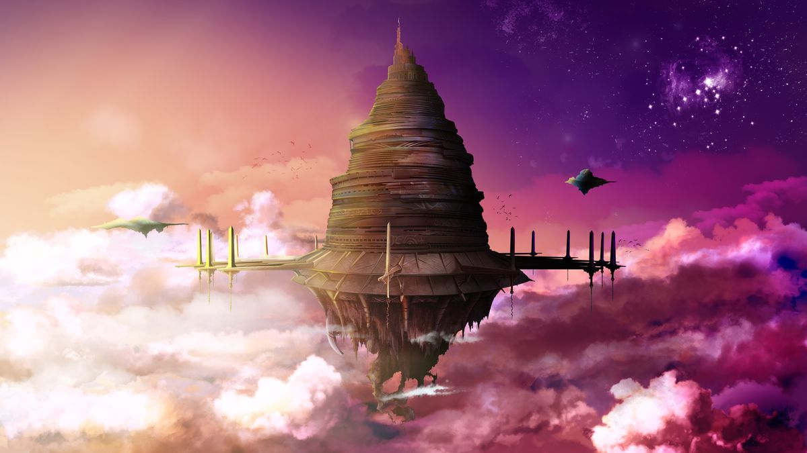
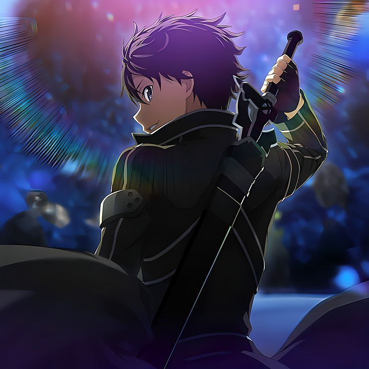
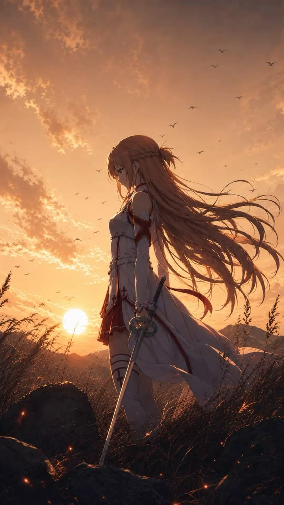

# Концепція проєкту: SAO — фан-сайт про Айнкрад

## Тип проєкту
Тематичний інформаційний сайт (фан-проєкт) за світом Sword Art Online.

## Суть проєкту
Це тематичний сайт для фанатів аніме та ігор, який простою мовою розповідає про механіку гри Sword Art Online, історію Айнкрада, головних героїв і клани, щоб новачок міг швидко зрозуміти, що це за світ і чому гра стала смертельною.

## Цільова аудиторія
- Люди, які тільки починають знайомство з Sword Art Online і хочуть швидко розібратися в сюжеті та правилах гри.
- Фанати аніме та VR-ігор, які шукають зручний зібраний опис персонажів, кланів і поверхів Айнкрада.
- Задача відвідувача: за кілька хвилин зрозуміти, як працює гра, хто такі головні герої та які угруповання діють в Айнкраді.

## Структура сайту

### 1. Головна
- Призначення: перше враження і навігація по сайту.
- Контент: назва сайту, яскрава ілюстрація Айнкрада, 2–3 речення про світ SAO, кнопки переходу до розділів.

### 2. Айнкрад
- Призначення: розповісти про головне місце дії.
- Контент: що таке Айнкрад (летючий залізний замок зі 100 поверхами), як влаштований поверх (місто, лабіринт, бос), ключові поверхи (1-й, 22-й, 74-й, 75-й), картинка або схема замку.

### 3. Механіка гри
- Призначення: пояснити правила світу гри.
- Контент:
  - гра запускається через шолом NerveGear, повне занурення у віртуальний світ;
  - магії немає, основа бою — мечі та навички меча (Sword Skills);
  - рівні, смужка HP, інвентар і меню, крафт, гільдії;
  - головне правило: смерть у грі означає смерть у реальності;
  - кольори курсорів: зелений — звичайний гравець, жовтогарячий — злочинець, червоний — вбивця;
  - безпечні зони в містах;
  - унікальні навички (наприклад, Dual Blades у Кіріто).

### 4. Історія: чому гра стала смертельною
- Призначення: коротка історія початку.
- Контент:
  - 6 листопада 2022 року стартувала гра, до неї увійшли близько 10 000 гравців;
  - творець гри Каяба Акіхіко оголосив у Місті Початку, що вийти з гри неможливо;
  - смерть у грі вбиває гравця в реальності, спроба зняти NerveGear ззовні теж смертельна;
  - щоб вийти, потрібно пройти всі 100 поверхів і перемогти останнього боса;
  - мотив Каяби: створити власний світ із літаючим замком і побачити його «живим»;
  - гра тривала два роки, за цей час загинуло близько 4 000 гравців.

### 5. Персонажі
- Призначення: познайомити з головними героями.
- Контент (фото + короткий опис для кожного):
  - **Кіріто** — гравець-одинак, колишній бета-тестер, «Чорний мечник», майстер двох мечів;
  - **Асуна** — «Блискавка», майстриня рапіри, пізніше заступниця командира гільдії Лицарі Кривавої Клятви;
  - **Клейн** — перший друг Кіріто в грі, лідер гільдії Фурінкадзан, воїн із катаною;
  - **Юі** — штучний інтелект, якого Кіріто та Асуна знаходять на 22-му поверсі і ростять як доньку;
  - **Каяба Акіхіко** — творець гри, у грі виступає під іменем Хізкліф.

### 6. Клани та гільдії
- Призначення: розповісти про угруповання Айнкрада.
- Контент:
  - **Лицарі Кривавої Клятви (KoB)** — найсильніша гільдія, яку очолює Хізкліф;
  - **Divine Dragon Alliance (DDA)** — сильна гільдія-суперник у проходженні босів;
  - **Aincrad Liberation Squad («Армія»)** — велика гільдія, що контролювала нижні поверхи;
  - **Фурінкадзан** — дружня гільдія Клейна;
  - **Laughing Coffin** — злий червоний клан вбивць на чолі з PoH, які вбивали гравців заради розваги.

### 7. Про автора і контакти
- Призначення: інформація про того, хто зробив сайт.
- Контент: ім'я/нік, посилання на GitHub, зв'язок, джерела інформації (оригінальні романи Рекі Кавахари, аніме студії A-1 Pictures).

## Референси
1. Sword Art Online Wiki (swordartonline.fandom.com) — зручна структура розділів: персонажі, локації, гільдії. Беру ідею розбиття інформації за категоріями.
2. Офіційний сайт аніме Sword Art Online (sword-art-online.net) — стиль подачі, темна кольорова гама та великі ілюстрації. Беру ідею головної сторінки.
3. Ще один референс (знайди і додай сам): будь-який сайт-фандом чи гру-лендінг, який сподобався оформленням. Напиши, що саме взяв за основу.

## Візуальний стиль (початкові ідеї)
- Темний фон із синьо-фіолетовими акцентами, шрифт для заголовків у стилі гри.
- Великі ілюстрації в шапці розділів, картки для персонажів і кланів.
## Візуальні матеріали

