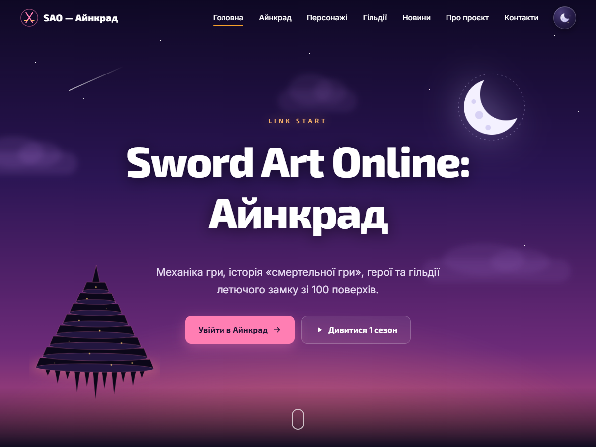

# SAO — Айнкрад · власна тема WordPress

Курсова робота: **«Розробка корпоративного сайту на WordPress зі створенням власної теми»**.

Сайт про світ Sword Art Online, побудований як корпоративний: головна з hero-блоком, «команда» (персонажі),
«партнери» (гільдії), новини-блог, сторінка «Про проєкт» і форма зворотного зв'язку з заявками в адмінці.
Тему **SAO Aincrad** написано з нуля: без готових тем, конструкторів сторінок і плагінів.



- **Живий сайт:** [sao-aincrad.freepage.cc](https://sao-aincrad.freepage.cc) (хостинг InfinityFree)
- **Тема:** папка [`sao-aincrad/`](sao-aincrad/)

## Можливості

| | |
|---|---|
| 🌗 **Світла / темна тема** | анімований перемикач «сонце ↔ місяць» у стилі меню SAO; нова тема розходиться колом від кнопки (View Transitions API) |
| 🌌 **Живе небо** | сонце «заходить», місяць «сходить», зорі мерехтять, пролітає падаюча зірка, пливуть хмари, над горизонтом висить Айнкрад з вогниками |
| ⚔️ **Інтро LINK START** | при першому відкритті — кольоровий «тунель», як при вході в гру (раз за сесію, клік пропускає) |
| ✨ **Анімації** | поява блоків при прокрутці, лічильники цифр, SAO-рамка «прицілу» та смужка HP на картках, смужка HP прокрутки зверху |
| 👥 **Власні типи записів** | «Персонажі», «Гільдії», «Заявки» + додаткові поля (роль, лідер, тип гільдії, дата у світі SAO) |
| 📨 **Форма зв'язку** | перевірка полів у браузері й на сервері, відправка через REST API без перезавантаження, захист від спаму, заявки зберігаються в адмінці й надсилаються листом |
| 🎛 **Customizer** | тексти головного екрана, посилання, email, підвал — «Вигляд → Налаштувати → Тема SAO Aincrad» |
| 📱 **Адаптивність** | телефон / планшет / ПК, мобільне меню; доступність: skip link, aria-атрибути, `prefers-reduced-motion` |
| 🚀 **Демо-вміст** | при активації теми автоматично створюються сторінки, персонажі, гільдії, 9 новин і меню |

## Структура репозиторію

```
SAO/
├── sao-aincrad/            ← ТЕМА WORDPRESS (це завантажується на хостинг)
│   ├── style.css           заголовок теми (назва, автор, версія)
│   ├── functions.php       налаштування, підключення CSS/JS, SEO-мітки, меню
│   ├── header.php          <head>, верхня панель, меню, перемикач теми, інтро
│   ├── footer.php          підвал
│   ├── front-page.php      головна сторінка (усі секції)
│   ├── index.php           список новин і запасний шаблон
│   ├── single.php          окрема новина / персонаж / гільдія
│   ├── page.php            звичайна сторінка
│   ├── page-contacts.php   шаблон «Контакти» з формою
│   ├── archive.php         /characters/, /guilds/, мітки
│   ├── search.php, searchform.php, 404.php, comments.php, sidebar.php
│   ├── screenshot.png      прев'ю теми в адмінці
│   ├── template-parts/     картки, пункт новини, форма
│   ├── inc/
│   │   ├── post-types.php     типи записів і мета-поля
│   │   ├── customizer.php     налаштування Customizer
│   │   ├── contact-form.php   REST API /wp-json/sao/v1/contact
│   │   ├── template-tags.php  допоміжні функції, SVG сонця/місяця/неба/Айнкрада
│   │   └── demo-content.php   демо-вміст при активації
│   └── assets/  css/main.css · js/theme.js · js/contact.js · images/ · icons/
├── blueprint.json          налаштування для локального запуску (WordPress Playground)
└── practicals/             попередні практичні роботи (статичний сайт, React, Node API)
```

## Як працює перемикач «сонце ↔ місяць»

1. **Скрипт у `<head>`** (`functions.php` → `sao_theme_boot_script`) ще до відмальовки читає вибір з `localStorage`
   (або системну тему) і ставить `<html data-theme="dark|light">`. Тому сторінка не «блимає».
2. **Кнопка** (`sao_theme_toggle()` в `inc/template-tags.php`) — один SVG, де намальовані і сонце (ядро + 8 променів-«клинків»),
   і місяць (коло з вирізом через `<mask>`, кратери, зірки).
3. **CSS** (`main.css`, розділ 4): залежно від `data-theme` неактивна іконка повертається на 140° і зменшується до нуля,
   а активна «вилітає» з пружинним ефектом `cubic-bezier(.34, 1.56, .64, 1)`. Промені сонця повільно обертаються, зірки мерехтять;
   при наведенні з'являються помаранчеве світіння і пунктирне кільце, як у меню SAO.
4. **JavaScript** (`theme.js`) при кліку викликає `document.startViewTransition()`: браузер «фотографує» стару сторінку,
   а нову показує анімацією `clip-path: circle()` — коло росте від кнопки на весь екран.
   У Firefox (немає цього API) кольори просто плавно змінюються через `transition`.
5. **Небо** реагує на той самий атрибут: сонце опускається за горизонт, місяць піднімається, зорі й вогники Айнкрада з'являються лише вночі.

## Запуск локально (без XAMPP, потрібен лише Node.js)

```
npx @wp-playground/cli@latest server --mount=./sao-aincrad:/wordpress/wp-content/themes/sao-aincrad --blueprint=./blueprint.json
```

Відкрити http://127.0.0.1:9400 (адмінка — `/wp-admin`, вхід виконується автоматично). Дані зберігаються лише до зупинки сервера.
У Git Bash перед командою додайте `MSYS_NO_PATHCONV=1`.

## Встановлення на хостинг

1. Створити ZIP теми (папка `sao-aincrad` всередині архіву):
   ```
   git archive -o sao-aincrad.zip --prefix=sao-aincrad/ HEAD:sao-aincrad
   ```
2. Встановити WordPress на хостингу, мова — українська.
3. **Вигляд → Теми → Додати нову → Завантажити тему** → `sao-aincrad.zip` → **Активувати**.
   Сторінки, персонажі, гільдії, новини й меню створяться автоматично.
4. За бажанням: **Налаштування → Постійні посилання → Зберегти** (оновлює адреси `/characters/`, `/guilds/`).

## Технології

WordPress 6+, PHP 7.4+, HTML5, CSS3 (custom properties, grid, flexbox, `color-mix`, анімації), JavaScript (ES5+, View Transitions API,
IntersectionObserver, Fetch API), REST API WordPress, Google Fonts (Exo 2, Inter), Git.

## Автор

[Kirito072024](https://github.com/Kirito072024) · Фан-проєкт для навчання. Sword Art Online створив Рекі Кавахара, аніме — студія A-1 Pictures.
